## MIRA -- Dashboard Interativo

Uma solução demonstrativa para acompanhamento de indicadores, metas e resultados por meio de Business Intelligence e Gamificação.

## Sobre o projeto

O MIRA surgiu a partir da identificação de uma dificuldade no acompanhamento de uma certificação de parceiros B2B, que envolve diferentes indicadores comerciais e de qualidade, regras de negócio e metas.

A proposta foi estruturar um dashboard interativo capaz de centralizar informações, automatizar cálculos, apresentar projeções e facilitar a análise dos resultados.

## Objetivo

Transformar informações distribuídas em diferentes bases e relatórios em uma experiência mais visual, organizada e estratégica, apoiando o acompanhamento de resultados e a identificação de oportunidades.

## Funcionalidades

1. Centralização de indicadores comerciais e de qualidade
2. Acompanhamento de metas e projeções
3. Simulação de cenários
4. Análise histórica dos indicadores
5. Identificação de oportunidades e pontos de atenção
6. Gamificação por meio da personagem Mira

## Processo de desenvolvimento

1. Entendimento do cenário: identificação das dificuldades e necessidades da operação
2. Estruturação: organização das regras de negócio, metas e funcionalidades
3. Desenvolvimento: construção da interface e dos recursos interativos com apoio de IA
4. Validação: conferência dos cálculos, regras e funcionamento das funcionalidades

## Utilização de inteligência artificial

A inteligência artificial foi utilizada como ferramenta de apoio à programação. A idealização, o entendimento do negócio, a definição das regras, a estruturação das funcionalidades e as decisões do projeto fizeram parte da minha atuação.

## Conhecimentos aplicados

1. Business Intelligence
2. Análise e interpretação de indicadores
3. Regras de negócio
4. Estruturação de soluções
5. Visualização de dados
6. Gamificação e experiência do usuário

## Apresentação completa

Conheça em detalhes o desenvolvimento do MIRA, desde a identificação do problema até a estruturação das funcionalidades e validação da solução

**[Baixar apresentação completa do MIRA (PowerPoint)](./Mira_Portfolio_Dashboard.pptx)**

## Demonstração visual

### Ficha principal
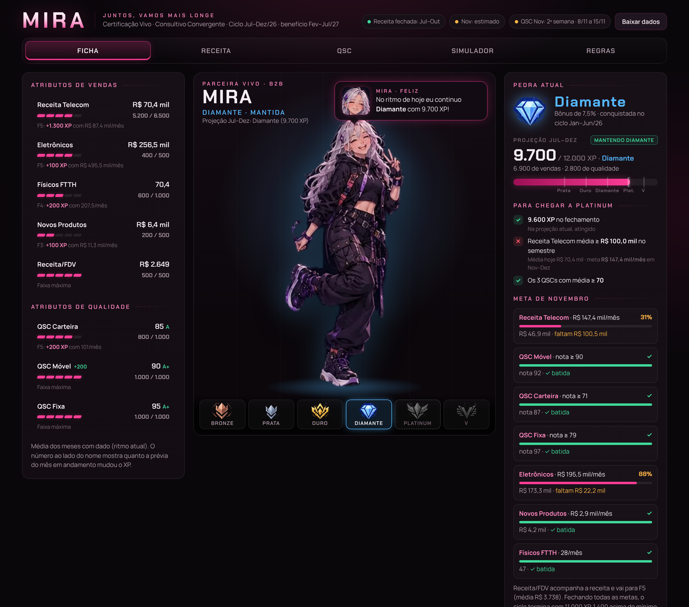

### Metas e resultados
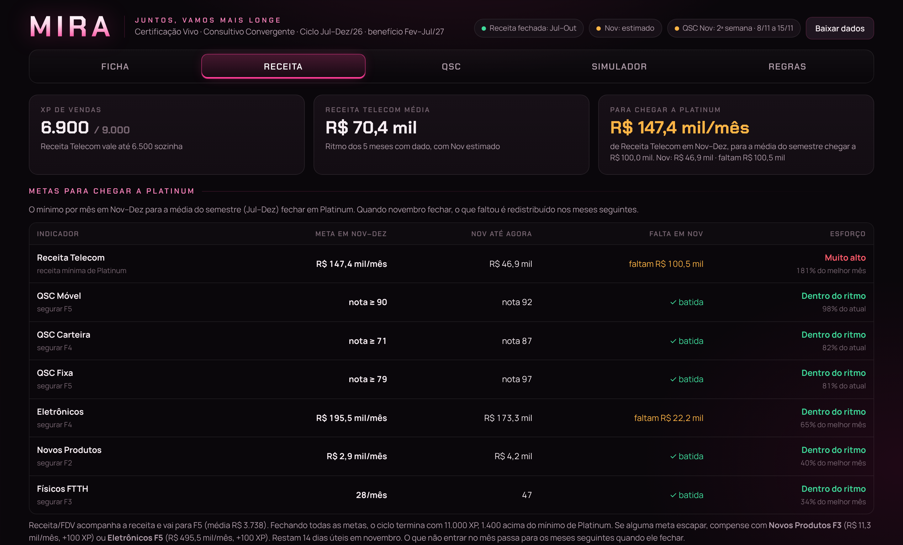

### Simulador
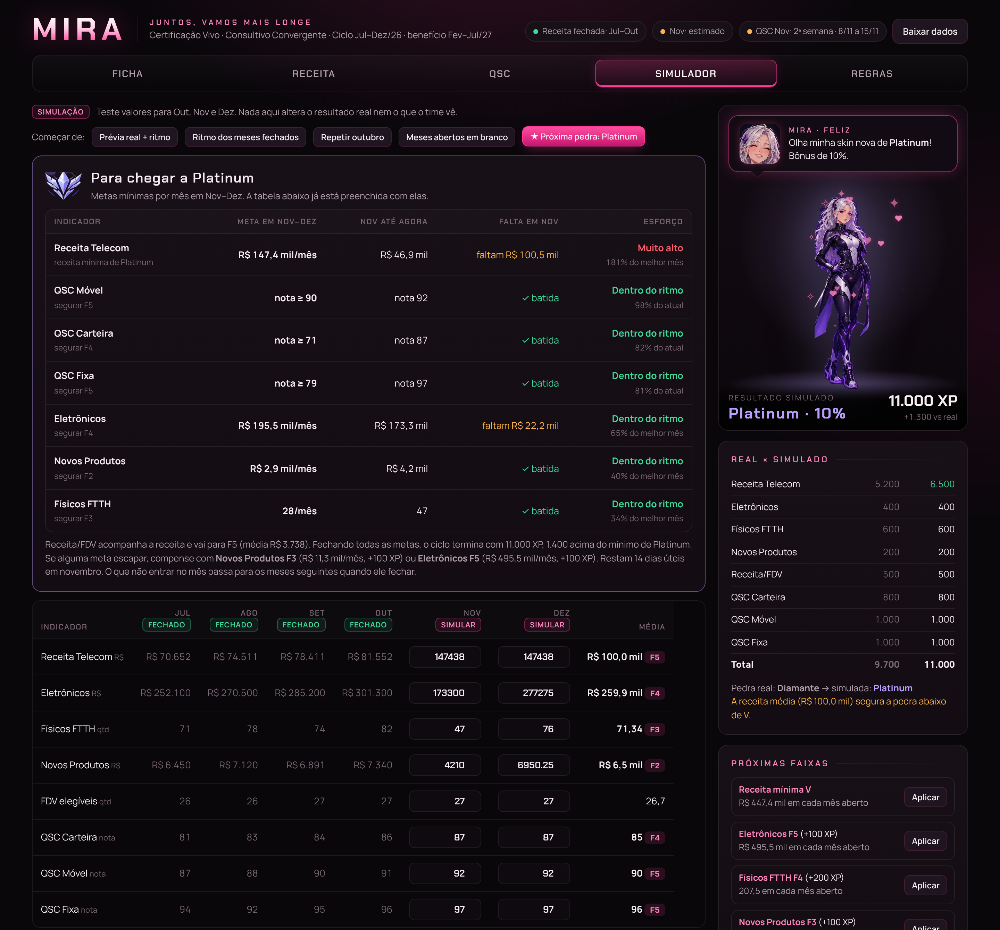

### Indicadores de qualidade (QSC)
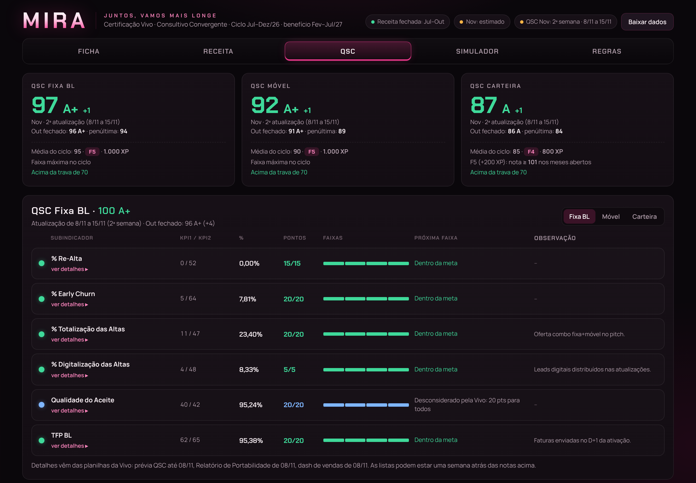

### Evolução da personagem
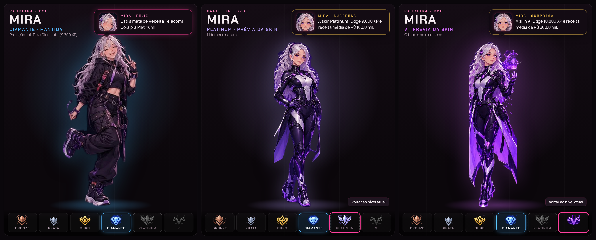

### Evolução dos indicadores
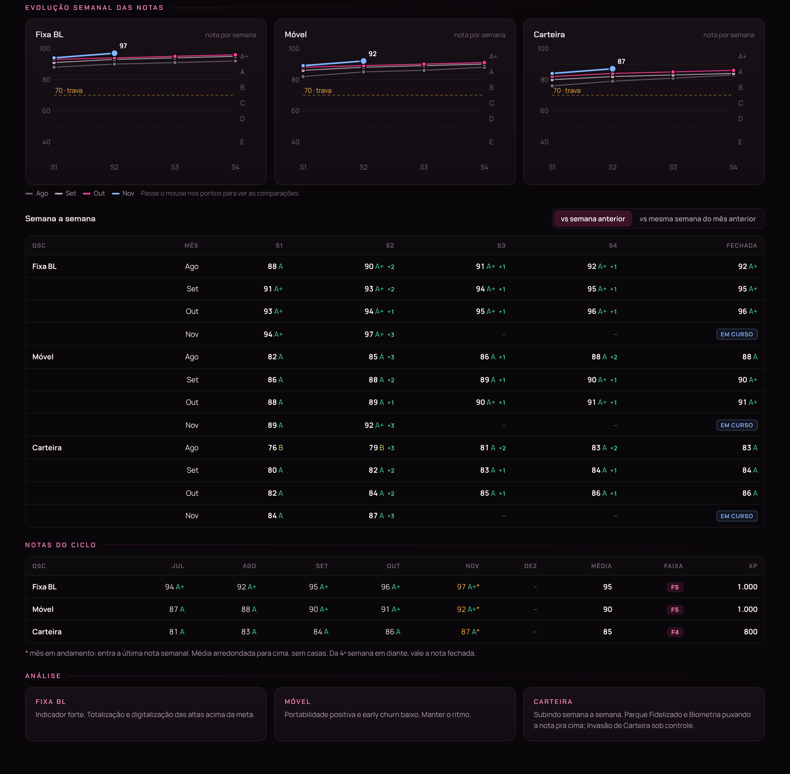

### Faixas de pontuação
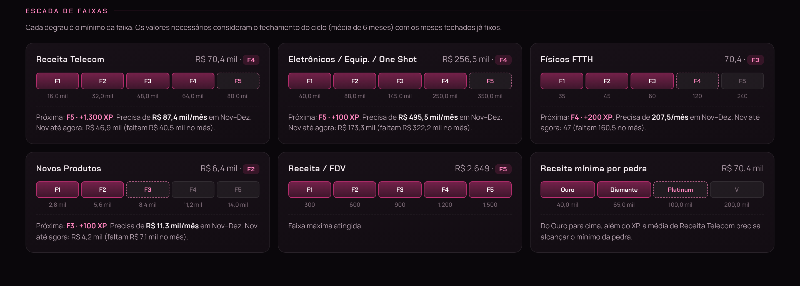

### Reações da Mira
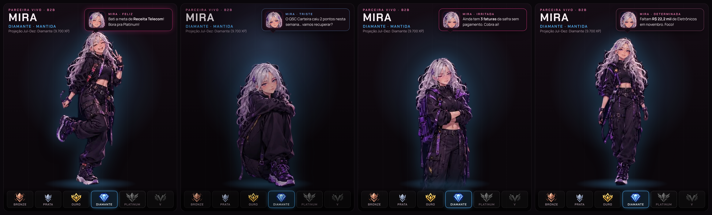

### Previsão de vendas
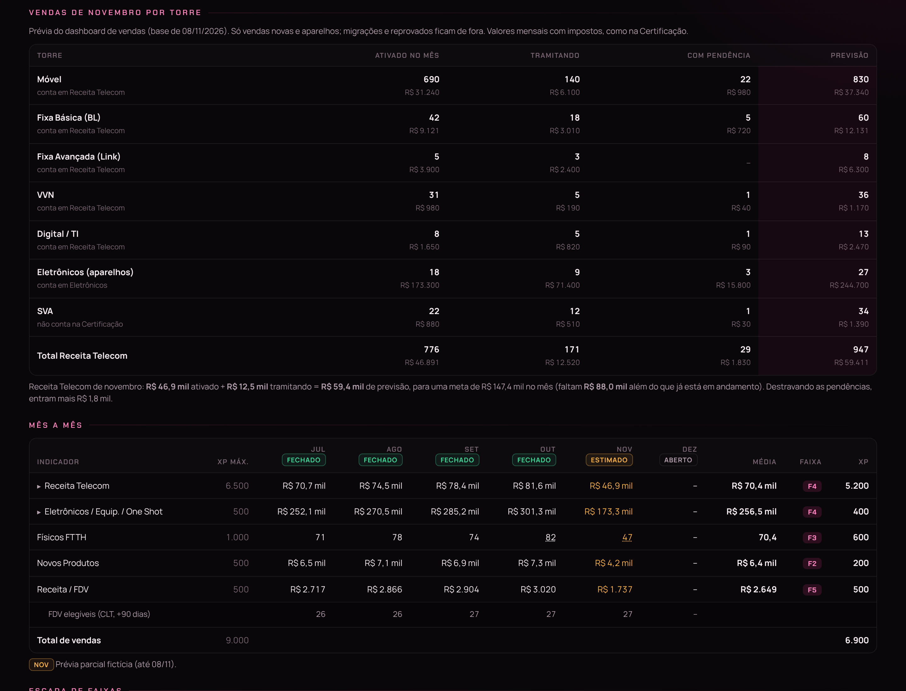

### Detalhamento da carteira
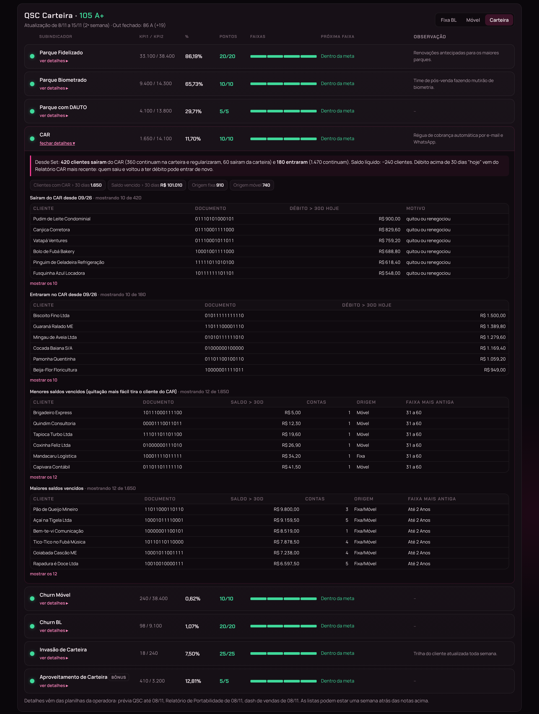

### Movimentação da carteira
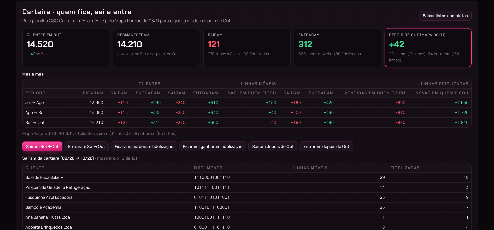

### Análise de portabilidade
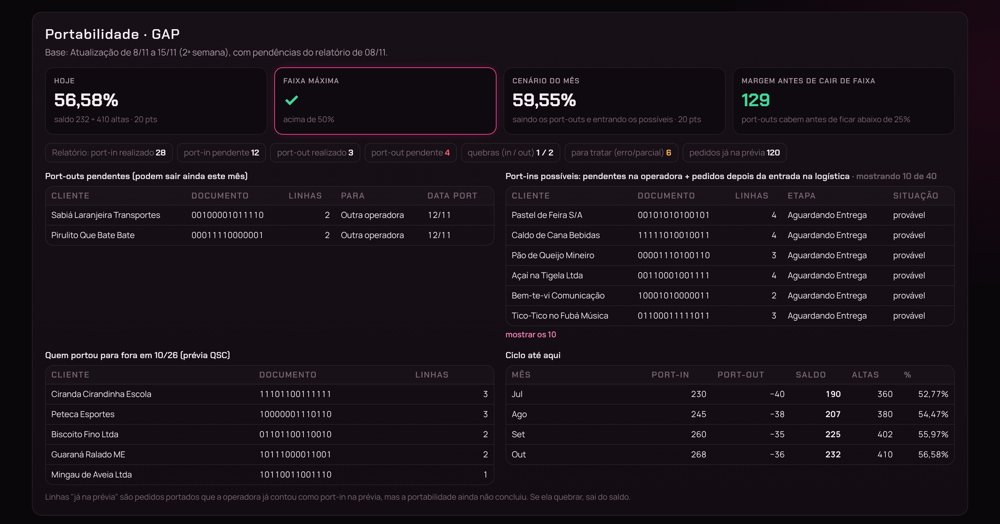

## Observações

Este projeto é uma demonstração de portfólio; Todos os dados, nomes de clientes, CNPJs e resultados apresentados são fictícios.

⸻

Desenvolvido como projeto de portfólio por Raphaela Santos
